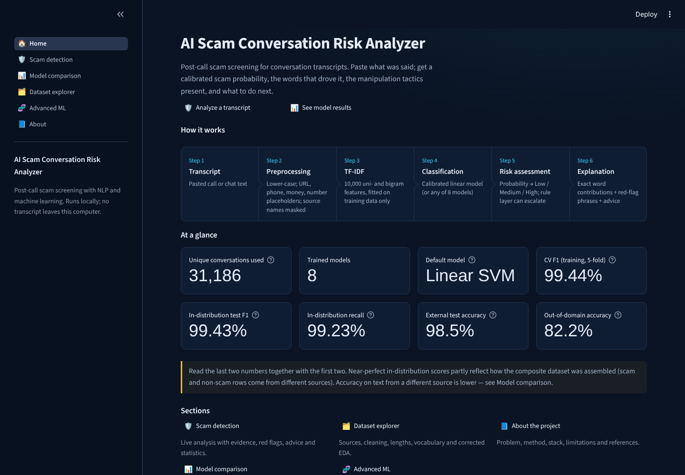
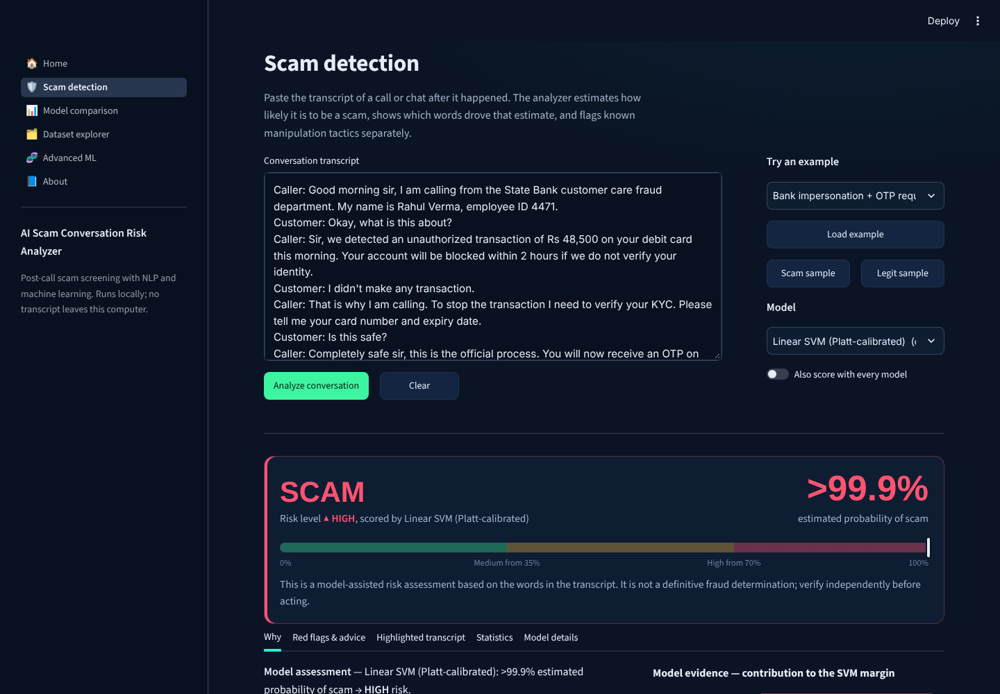
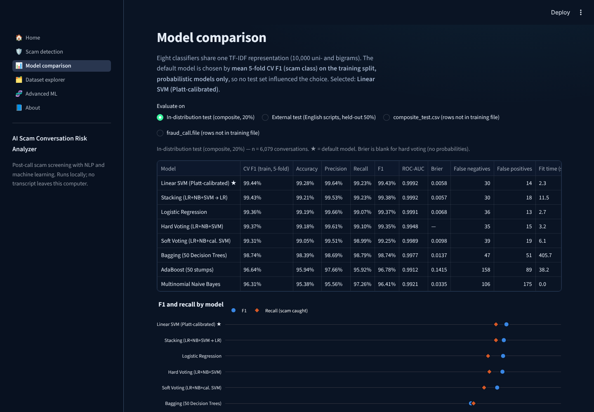
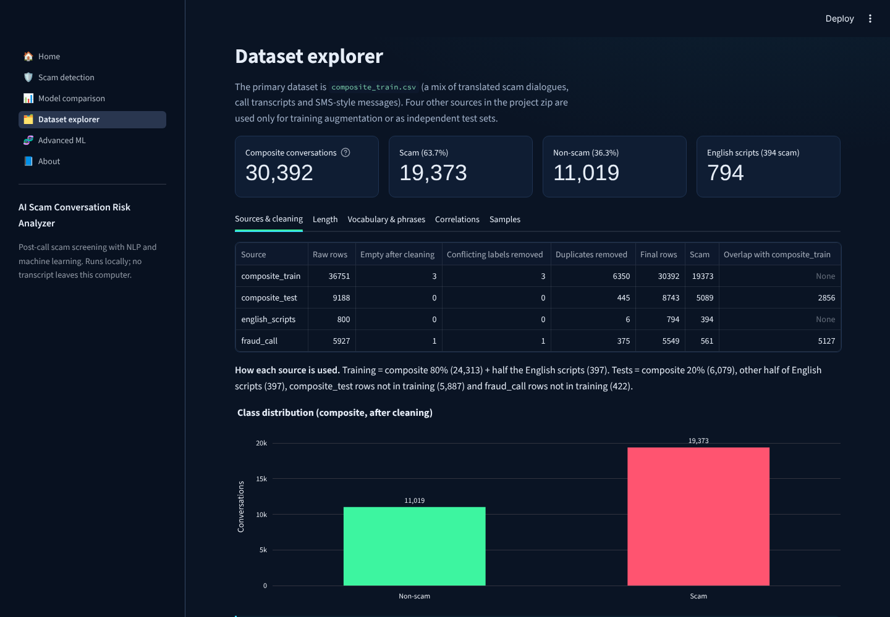

# AI Scam Conversation Risk Analyzer

**Post-call scam detection, risk assessment and suspicious-pattern analysis with NLP and machine learning.**

Paste the transcript of a finished call or chat. The app returns a scam / non-scam prediction, a **calibrated** probability with a Low / Medium / High risk level, the words that drove the decision (exact model evidence), the manipulation tactics present (transparent rules, shown separately), conversation statistics and safety advice. It runs entirely on your machine — no paid APIs, no data leaves the computer.

> The output is a model-assisted risk assessment, not a definitive fraud determination.

---

## Contents
1. [Problem & objectives](#1-problem--objectives)
2. [Features](#2-features)
3. [Quick start](#3-quick-start)
4. [System architecture & workflow](#4-system-architecture--workflow)
5. [Dataset](#5-dataset)
6. [Methods](#6-methods)
7. [Results](#7-results)
8. [Screenshots](#8-screenshots)
9. [Project structure](#9-project-structure)
10. [Testing](#10-testing)
11. [Limitations & future scope](#11-limitations--future-scope)
12. [Documentation & references](#12-documentation--references)

---

## 1. Problem & objectives
Scam calls use impersonation, urgency and manipulation. Victims often realise only afterwards, and reading a long transcript for warning signs is slow. Keyword lists alone miss context and raise false alarms.

| Objective | How it is met |
|---|---|
| **Scam classification** — classify conversations, compare models | 8 classifiers on a shared TF-IDF representation, selected by 5-fold CV, evaluated on 4 held-out sets |
| **Pattern identification** — suspicious words, phrases, conversational patterns | Exact per-term contributions; 10-category rule layer; EDA of distinctive n-grams; clustering topics; HMM stage analysis |
| **Risk assessment** — probability, risk level, indicators, advice | Platt-calibrated probability → configurable thresholds; rule escalation; tailored recommendations |

## 2. Features
- **Scam detection page** — large transcript box, example transcripts, model selector, SCAM / NON-SCAM verdict, probability meter with thresholds, Low/Medium/High risk, exact word-level evidence chart, rule-based red flags with severity, safe-signal detection ("we will never ask for your OTP"), highlighted transcript, HMM stage trace, conversation statistics, recommendations (incl. India's 1930 cyber-fraud helpline), optional scoring by all 8 models.
- **Model comparison** — metrics on four test sets, confusion matrices, ROC / PR / reliability curves, CV table, ablations explaining the scores, hyper-parameter study.
- **Dataset explorer** — sources & cleaning log, class balance, length distributions (with corrected interpretation), top uni/bigrams, distinctive terms, Pearson vs Spearman heatmap, source-artifact table, PII-masked samples.
- **Advanced ML** — supervised vs unsupervised vs sequential explainer; 8 clustering methods in one feature space; class-conditional HMMs with from-scratch Forward / Backward / Viterbi verified against `hmmlearn`.
- **About** — problem, method, data, architecture, limitations, future work, references.

## 3. Quick start
Requires Python 3.11+ (tested on 3.13 with scikit-learn 1.9.1), ~2 GB RAM. The shipped `.joblib` models were saved with scikit-learn 1.9.1; if your version differs and loading fails, run `python scripts/train_models.py`.

```bash
git clone <your-repo-url> && cd scam-risk-analyzer
python -m venv .venv && source .venv/bin/activate        # Windows: .venv\Scripts\activate
pip install -r requirements.txt

# Pre-trained models and reports are included (models/, reports/) — you can run the app immediately:
streamlit run app/streamlit_app.py

# To reproduce everything from scratch:
# 1. put the raw data files in data/raw/   (see data/README.md)
# 2. train + evaluate all models (≈ 45–70 min on 2 cores; --fast skips CV for Bagging/AdaBoost, ≈ 10 min)
python scripts/train_models.py
# 3. EDA, clustering and HMM reports (≈ 3–5 min)
python scripts/run_analysis.py
# 4. optional: hyper-parameter study shown on the Model Comparison page (≈ 7 min)
python scripts/tuning_study.py

# run the app (opens http://localhost:8501)
streamlit run app/streamlit_app.py

# tests
pytest
# terminal fallback (no browser)
python scripts/demo_cli.py "Sir, your account is blocked, share the OTP now"
```

Risk thresholds and app behaviour are in [`config/settings.toml`](config/settings.toml) — edit and restart, no retraining needed.

## 4. System architecture & workflow
```
data/raw/*  ──►  data.py  ──► clean · de-duplicate · drop conflicting labels · split ──► data/processed/*.csv
                                   │
               train.py ◄──────────┘   5-fold CV (TF-IDF refit per fold) → model selection
                  │                    fit 8 models on one TF-IDF → evaluate once on 4 test sets → ablations
                  ▼
     models/*.joblib, reports/metrics.json          eda.py → reports/eda.json
                                                    advanced.py → reports/advanced.json, models/hmm_models.joblib
                  │
                  ▼
  app/streamlit_app.py ── risk.ScamAnalyzer:
        transcript → preprocessing.clean_text → TF-IDF → model → calibrated P(scam) → risk level
                   → explain.contributions (exact x·w)   → indicators.detect_indicators (rules, separate)
                   → recommendations, statistics, HMM decoding → UI
```
Pipeline shown in the app: **Transcript → Preprocessing → TF-IDF → ML classification → Risk assessment → Explanation.**

## 5. Dataset
| Source | Raw | After cleaning | Used for |
|---|---|---|---|
| `composite_train.csv` | 36,751 | 30,392 (19,373 scam / 11,019 non-scam) | 80% train / 20% in-distribution test (stratified, `random_state=42`) |
| `English_Scam.txt` + `English_NonScam.txt` | 800 | 794 | 50% added to training / 50% external test |
| `composite_test.csv` | 9,188 | 5,887 not in training | extra in-distribution test |
| `fraud_call.file` | 5,927 | 422 not in training | extra SMS-style test |

Data files are not committed — see [`data/README.md`](data/README.md).

**Audit findings** (full report: [`docs/01_audit_report.md`](docs/01_audit_report.md)): the original notebooks used only `composite_train.csv`; the historical 99% results reproduce within 0.2 points; but the composite data contains strong **source shortcuts** (77% of scam rows use a list-of-utterances format no non-scam row has; translated names like "zhang" occur only in scam rows; length alone is highly predictive). A model reading **no words at all** reaches 92.8% accuracy. We therefore report external and out-of-domain results alongside the in-distribution score.

## 6. Methods
- **Preprocessing** (one function for training and inference): lower-case; `<URL>`, `<EMAIL>`, `<PHONE>`, `<MONEY>`, `<NUMBER>`, `<PAYMENT_APP>` placeholders; punctuation removed; source-identifying names masked; empty / duplicate / conflicting-label rows dropped.
- **Features:** TF-IDF, 10,000 uni+bigrams (original setting, confirmed by a CV study), fitted on training data only.
- **Models** (all from the original notebooks): Logistic Regression (C = 10, CV-tuned), Multinomial NB (α = 0.1, CV-tuned), Linear SVM with Platt calibration, Hard Voting, Soft Voting (now including the calibrated SVM), Stacking (LR meta-learner, cv = 5), Bagging (50 trees), AdaBoost (50 stumps).
- **Selection:** mean 5-fold stratified CV F1 on the training split; test sets never used for decisions.
- **Risk:** LOW < 0.35 ≤ MEDIUM < 0.70 ≤ HIGH on the calibrated probability (configurable). A HIGH-severity rule match can raise LOW to MEDIUM; the probability is never altered.
- **Explanations:** exact additive contributions x·w for linear models; rule indicators (10 categories, HIGH/MEDIUM severity) shown separately.
- **Regression** (Linear / Ridge / Lasso) is kept only as an academic comparison in the notebooks: outputs leave [0, 1] and are not probabilities, so they are never used as a risk score.
- **Supplementary:** clustering (K-Means, GMM, Ward/single/complete/average, Spectral, BIRCH) in a 50-D LSA space; class-conditional categorical HMMs over manipulation-stage symbols.

## 7. Results
<!-- RESULTS:START -->
All numbers below are generated from `reports/metrics.json` by `scripts/make_results_tables.py` (seeded, reproducible). *Test* = in-distribution composite test (n = 6,079); *Ext.* = held-out English scripts (n = 397). Selection uses CV F1 only.

**All models**

| Model | CV F1 (5-fold, train) | Test acc. | Precision | Recall | F1 | ROC-AUC | Brier | FN | FP | Ext. acc. | Ext. recall |
|---|---|---|---|---|---|---|---|---|---|---|---|
| Linear SVM (Platt-calibrated) **(default)** | 99.44 ± 0.07 | 99.28 | 99.64 | 99.23 | 99.43 | 0.9992 | 0.0058 | 30 | 14 | 98.5 | 98.5 |
| Stacking (LR+NB+SVM → LR) | 99.43 ± 0.08 | 99.21 | 99.53 | 99.23 | 99.38 | 0.9992 | 0.0057 | 30 | 18 | 98.5 | 98.0 |
| Logistic Regression | 99.36 ± 0.10 | 99.19 | 99.66 | 99.07 | 99.37 | 0.9991 | 0.0068 | 36 | 13 | 98.5 | 97.5 |
| Hard Voting (LR+NB+SVM) | 99.37 ± 0.10 | 99.18 | 99.61 | 99.10 | 99.35 | 0.9948 | — | 35 | 15 | 98.7 | 98.0 |
| Soft Voting (LR+NB+cal. SVM) | 99.31 ± 0.11 | 99.05 | 99.51 | 98.99 | 99.25 | 0.9989 | 0.0098 | 39 | 19 | 97.7 | 97.5 |
| Bagging (50 Decision Trees) | 98.74 ± 0.21 | 98.39 | 98.69 | 98.79 | 98.74 | 0.9977 | 0.0137 | 47 | 51 | 92.7 | 92.4 |
| AdaBoost (50 stumps) | 96.64 ± 0.09 | 95.94 | 97.66 | 95.92 | 96.78 | 0.9912 | 0.1415 | 158 | 89 | 81.1 | 82.2 |
| Multinomial Naive Bayes | 96.31 ± 0.11 | 95.38 | 95.56 | 97.26 | 96.41 | 0.9921 | 0.0335 | 106 | 175 | 85.1 | 87.3 |

**Default model on every test set**

| Test set (default model) | n | Accuracy | Precision | Recall | F1 |
|---|---|---|---|---|---|
| In-distribution test (composite, 20%) | 6,079 | 99.28 | 99.64 | 99.23 | 99.43 |
| External test (English scripts, held-out 50%) | 397 | 98.49 | 98.48 | 98.48 | 98.48 |
| composite_test.csv (rows not in training file) | 5,887 | 99.47 | 99.69 | 99.62 | 99.65 |
| fraud_call.file (rows not in training file) | 422 | 96.92 | 85.71 | 83.72 | 84.71 |

**Ablations (why the scores look the way they do)**

| Ablation | Result |
|---|---|
| Notebook Logistic Regression accuracy (reported → reproduced) | 98.87 → 98.90 |
| Notebook Naive Bayes accuracy (reported → reproduced) | 95.07 → 95.02 |
| Notebook Linear SVM accuracy (reported → reproduced) | 99.42 → 99.26 |
| Format/length-only Random Forest (no words) | 92.84 accuracy (majority baseline 63.74) |
| Out-of-domain: Logistic Regression trained on composite only → all English scripts | 82.49 acc., 80.20 recall |
| Out-of-domain: Linear SVM (Platt-calibrated) trained on composite only → all English scripts | 82.24 acc., 78.68 recall |
| Out-of-domain: Multinomial Naive Bayes trained on composite only → all English scripts | 75.19 acc., 88.07 recall |
| LR external accuracy, names masked vs kept | 98.49 vs 98.49 |
| Test rows with a near-duplicate (cos ≥ 0.9) in training | 13.7%; default-model accuracy without them 99.18 |

**Supplementary:** class-conditional HMMs reach 86.2% accuracy in-distribution vs 83.8% for an order-blind baseline on the same symbols (74.1% vs 75.8% externally); clustering agrees weakly with labels (best ARI 0.077), but K-Means topics (k = 8) separate courier, bank, investment, lottery, emergency and casual-chat themes.

**Known failure case:** a genuine bank fraud-alert call ("we will never ask for your OTP") is scored >99% scam — bank-card conversations are almost always scams in the training data and bag-of-words ignores negation. The rule layer correctly finds no credential request. Documented as an `xfail` test.
<!-- RESULTS:END -->

**Reading the results.** In-distribution scores are near-perfect for every linear model and the differences between the top models are within cross-validation noise. The more informative numbers are the external and out-of-domain rows: performance on text from a different source is lower, and the shortcut ablation shows why. False negatives (scams called safe) are the costlier error, so recall is reported throughout and the MEDIUM band starts below 0.5.

## 8. Screenshots
Captured from the running app with `scripts/capture_screenshots.py` (headless Chromium).

| Home | Scam detection |
|---|---|
|  |  |
| **Model comparison** | **Dataset explorer** |
|  |  |

## 9. Project structure
```
scam-risk-analyzer/
├── app/
│   ├── streamlit_app.py        # entry point (st.navigation)
│   ├── ui.py                   # theme, CSS, Plotly template, cached loaders
│   ├── examples.py             # demo transcripts (fictional)
│   └── views/                  # home, detect, models, dataset, advanced, about
├── src/scam_analyzer/
│   ├── config.py               # paths, settings loader
│   ├── preprocessing.py        # clean_text (train = inference), legacy cleaning
│   ├── data.py                 # load, clean, de-duplicate, split
│   ├── models.py               # model factory + rationale
│   ├── train.py                # CV, fit, evaluate, ablations → metrics.json
│   ├── explain.py              # exact linear contributions
│   ├── indicators.py           # rule layer + HMM symbols
│   ├── risk.py                 # ScamAnalyzer (inference API)
│   ├── eda.py                  # → reports/eda.json
│   ├── advanced.py             # clustering + HMM → reports/advanced.json
│   └── hmm_algorithms.py       # scaled Forward / Backward / Viterbi from scratch
├── scripts/                    # train_models, run_analysis, tuning_study, demo_cli, make_results_tables, capture_screenshots, audit/
├── config/settings.toml        # risk thresholds, app options
├── notebooks/                  # original notebooks (unchanged)
├── docs/                       # audit, literature survey, explanations, viva Q&A, demo script, revision sheet, screenshots
├── tests/                      # unit, end-to-end (10 required cases), headless UI tests
├── data/                       # raw/ and processed/ (git-ignored), README
├── models/  reports/           # generated artifacts
├── requirements.txt  pytest.ini  .gitignore  .streamlit/config.toml
```

## 10. Testing
`pytest` runs three suites:
- `test_preprocessing_and_rules.py` — placeholders, masking, rule indicators, safe signals, and the from-scratch HMM algorithms against `hmmlearn` (log-likelihood, Viterbi path, posteriors, underflow).
- `test_analyzer_cases.py` — the 10 required cases (legitimate, obvious scam, OTP request, bank impersonation, urgency/threats, ambiguous, empty, very short, very long, irrelevant text) plus every model loading and predicting.
- `test_app_pages.py` — Streamlit `AppTest`: all six pages render without exceptions; scam, legitimate and empty inputs on the detection page.

## 11. Limitations & future scope
**Limitations:** dataset source shortcuts inflate in-distribution accuracy; bag-of-words cannot model intent, speaker roles or negation; little India-specific training data (OTP/UPI/KYC/Aadhaar are rare) and no Hinglish; text only; evadable by rephrasing; probabilities calibrated to a 64%-scam training mix, not real-world prevalence.

**Future scope:** train/evaluate on India-focused conversational data (e.g. ICFD-31k, English + Hinglish) and consented real transcripts; speaker-aware and streaming (in-call) detection; calibrated multilingual transformer baseline under the same protocol; prevalence-aware recalibration; user feedback loop.

## 12. Documentation & references
| Document | Content |
|---|---|
| [`docs/01_audit_report.md`](docs/01_audit_report.md) | Phase 1 audit: reproduction, leakage, shortcuts, EDA/PPT inconsistencies |
| [`docs/02_literature_survey.md`](docs/02_literature_survey.md) | 13 verified papers (2021–2026), comparison table, research gap, references |
| [`docs/03_project_explained.md`](docs/03_project_explained.md) | Whole project explained, plain language then technical |
| [`docs/04_viva_question_bank.md`](docs/04_viva_question_bank.md) | 60 faculty questions with answers |
| [`docs/05_demo_script.md`](docs/05_demo_script.md) | 5-minute demo script + backup plan |
| [`docs/06_quick_revision_sheet.md`](docs/06_quick_revision_sheet.md) | One-page revision |

Key references: Derakhshan et al. (2021, ACM IWSPA) · Tsinganos et al. (2022, IEEE Access) · Moussavou Boussougou & Park (2023, *Mathematics*) · Jáñez-Martino et al. (2023, *AI Review*) · Ghourabi & Alohaly (2023, *Sensors*) · Ai et al. (2024, EMNLP) · Salman et al. (2024, IEEE Access) · Ma et al. (2025, ACM MM) · Ahuja et al. (2026, IJCAI) · Uddin et al. (2026, *Computer Networks*); preprints: Wood et al. (2023), Dahiphale et al. (2024), Lochstampfor & Roy (2026). Full citations with DOIs in the literature survey.
